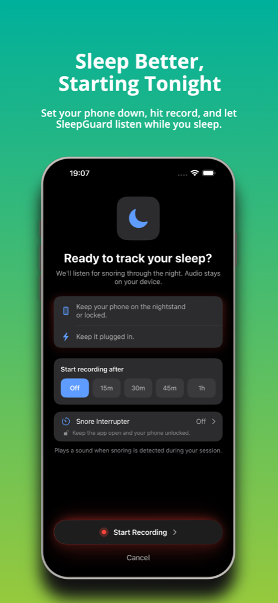
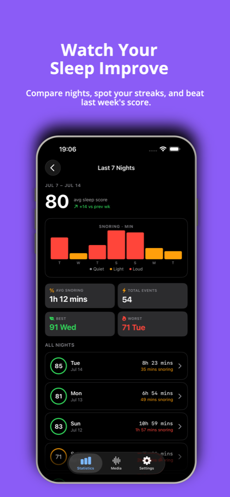
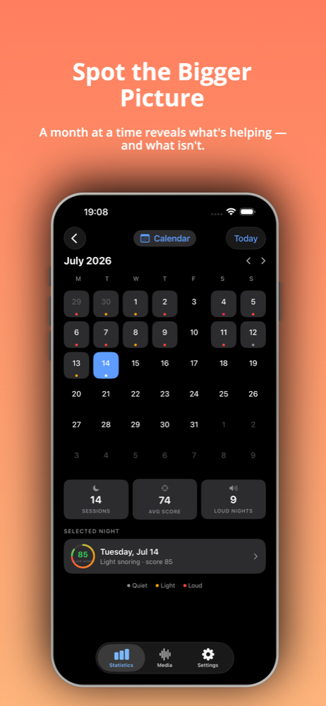
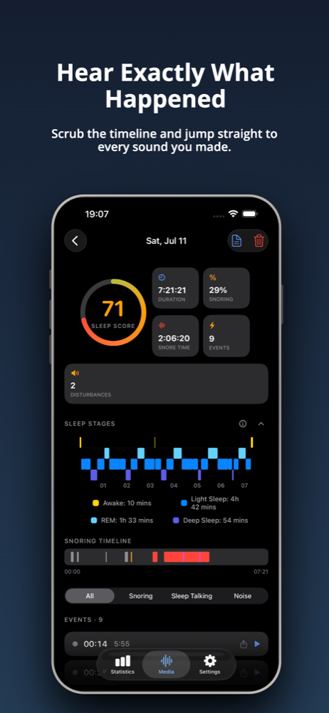
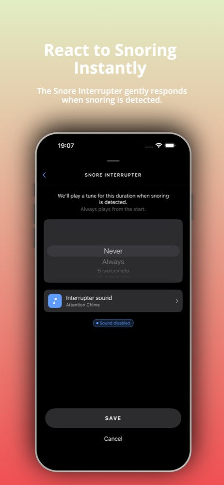

# SleepGuard

> Your bedside sleep lab. SleepGuard listens while you sleep, detects and records snoring and sleep talking, then scores your sleep and shows you how it trends over time.

**100% on-device.** All audio analysis runs locally on your iPhone using Apple's `SoundAnalysis` framework. No accounts, no servers, no audio ever leaves your phone.

📐 **How it's built and why:** the [Technical Overview](docs/TECHNICAL_OVERVIEW.md) covers the architecture, every package, the detection and scoring algorithms, Swift 6 concurrency, dependency injection, testing and CI, and the design decisions behind them.

🧩 **Built on a shared core.** The domain rules, strings, design system and screen layouts live in [SleepGuardShared](https://github.com/dardan0x/SleepGuardShared), a versioned Swift package this app builds against. Since the uniform-apps releases it also holds the stored nights' schema, the audio engine, the files and logging, the same code SleepGuardUIKitWay runs. This repo holds the app's own architecture: how it reads and writes nights, services, dependency injection, navigation and screens. [How the two connect](#how-it-uses-sleepguardshared).


<p align="center">
  
  
  
  
  
  
</p>

---

## What it does

SleepGuard turns your phone into a bedside monitor. Start a session, set it on your nightstand, and it captures the sounds of your night — then in the morning you get a sleep score, a timeline of what happened, and audio clips you can play back.

### Core capabilities

| | Feature | What it does |
|---|---------|--------------|
| 🌙 | **Live sleep session** | Bedside-clock UI with a real-time level meter, snoring glow, and live event detection. Keeps recording in the background, recovers from interruptions and route changes, saves automatically when the battery runs critically low, and can restore a night after a crash. |
| 🔊 | **Snore & sleep-talk detection** | Classifies **snoring** (quiet · light · loud · epic) and, optionally, **sleep talking**, using Apple's on-device sound classifier and the sound level. An FFT-based fallback is implemented and waiting for real-night validation. |
| 📊 | **Sleep quality score** | A 0–100 score derived from snoring percentage, event frequency, sleep-talking, and (when available) sleep-stage architecture. |
| 🎧 | **Audio playback** | Browse past nights, jump between events, and play each event's clip, with optional enhanced audio (normalization + bandpass cleanup). |
| 📈 | **Trends & statistics** | Dashboard, calendar, "Last 7 Nights" view, and weekly/monthly Swift Charts for sleep score, snoring time, and event frequency. |
| ⌚ | **Apple Watch + HealthKit** | Reads sleep stages from Apple Watch, overlays a hypnogram on your timeline, and writes sleep sessions back to Apple Health. |
| 📄 | **PDF sleep reports** | Export a polished report — score, stats, sleep-architecture breakdown, and a full event log — to share with a doctor or partner. |
| 🎵 | **Snore Interrupter** | An optional melody that plays when snoring is detected (built-in library + record-your-own). Recording pauses while it plays, and the gap counts as snoring only if snoring resumes afterwards. |
| ⏰ | **Delayed start** | Start recording after a countdown (15 min – 1 h), so falling asleep isn't recorded. |
| 🔒 | **Privacy-first** | Everything lives locally in SwiftData. No sign-in, no cloud, no tracking. |

---

## How detection works

```
CaptureEngine tap (SleepAudioKit) ──► level (RMS + peak dB) + SoundAnalysis snore / speech confidence
      │
      ▼  SampleDecimator: exactly 20 Hz
per-sample classifier ──► none · quiet · light · loud · epic
      │
      ▼  one ordered stream into the DetectionEngine actor
event rules: sustained ≥ 75 ms to start · 10 s silence to close · false-positive filters
      │
      ▼
NightEventRecord (bursts, intensity, duration) ──► per-event audio clip (.m4a)
```

- **Events** group continuous activity, merging brief breathing pauses (≤10 s) so one snoring spell is one event, not fifty.
- **Bursts** track the actual snoring segments inside an event, so "snoring time" reflects real snoring, not the silent gaps.
- Detection sensitivity is user-tunable (three presets, 5 dB apart), and sleep-talking detection is an opt-in toggle.
- The classifiers and the event rules are pure code in `SleepCore` (SleepGuardShared). This app supplies the audio and performs the outputs. Replay tests pin the rules' output on excerpts of a real night.
- Details: [Technical Overview §5](docs/TECHNICAL_OVERVIEW.md#5-snore-detection) and [`docs/snore-detection-algorithm.md`](docs/snore-detection-algorithm.md).

**Sleep score** starts at 100 and subtracts capped penalties for snoring time, snoring episodes per hour, snoring intensity, sleep talking, very short or long nights, and (when Watch data is present) sleep stages, against sleep-literature targets (deep ≥ 15%, REM ≥ 18%, awake ≤ 8%). The coefficients are product heuristics, not a clinical measure. Formula and worked example: [Technical Overview §6](docs/TECHNICAL_OVERVIEW.md#6-sleep-score).

---

## Architecture

> The short version is below. For the reasoning behind each decision (packages, MV instead of MVVM, Factory DI, the detection actor, Swift 6 isolation), see the [Technical Overview](docs/TECHNICAL_OVERVIEW.md) and the [architecture decision records](docs/adr/).

A modular Swift Package layout with strict isolation, enforced by the compiler through each `Package.swift`:

```
App target                 composition root: App, Tabs, Navigation (routes, deep links), NightFlow, Widgets, Firebase
└─► Features               one package, a module per feature: Onboarding · SleepSession · Statistics · Recordings ·
                           Settings · Personalization · Learn
    ├─► DesignSystem       Theme extensions, model → component adapters, a few app-only views
    ├─► Services           the recording night: session manager, detection tracker, committer, stores, interrupter
    │   ├─► AudioEngine    AudioRecorder over SleepAudioKit's CaptureEngine
    │   ├─► Config         remote config (held per night), preferences
    │   ├─► Health         HealthKit sync over SleepHealthKit
    │   └─► Platform       haptics, notification permission, Watch
    ├─► Routing            route enums, RouterPath, root presentation policy, tab coordinator
    └─► Models             SleepGuard's reads on the shared nights database, file layout, widget snapshot
            │
            ▼
SleepGuardShared           SleepCore · SleepStore · SleepAudioKit · SleepFiles · SleepSettings · SleepHealthKit ·
(pinned release)           SleepLogging · SleepNotifications · SleepStrings · SleepMelodies · DesignKit · ContentKit
```

- Each layer depends only on layers below it. `Models` and `AudioEngine` use only SleepGuardShared; `Platform` uses nothing local.
- **Features never import each other.** They are targets in one `Features` package ([ADR 0011](docs/adr/0011-features-package.md)) and talk through route enums in `Routing` (`RouterDestination`, `SheetDestination`; [ADR 0001](docs/adr/0001-routing-package.md)), and only the app target's `AppRegistry` maps a route to a screen.
- **Every dependency is explicit.** No `@_exported import`: each file imports what it uses and each target declares it, packages and the app and widget targets alike (`check-imports.py`, `check-layering.py`).
- The local packages appear as the `Packages` folder in the project; only SleepGuardShared and Firebase are package dependencies.
- The widget extension reuses `Models` + `DesignSystem` and reads a JSON snapshot from the App Group, never SwiftData.

The seven features (SleepSession to Learn below) are targets of one `Packages/Features` package; the rest are their own packages.

| Package | Size | Depends on | SleepGuardShared | Responsibility |
|---------|------|-----------|------------------|----------------|
| `Models` | 11 files · 0.6k lines | — | SleepCore, SleepStore, SleepFiles, SleepLogging | SleepGuard's reads on the shared `NightRecord` / `NightEventRecord`, the launch re-score of stale summaries, the file layout (`SleepGuardStorage`), widget snapshot |
| `AudioEngine` | 4 · 0.3k | — | SleepCore, SleepAudioKit, SleepLogging | `AudioRecording` / `AudioRecorder` over `CaptureEngine`: published levels and confidences, interruptions, warm-up, melody pause; `LegacyClipPlayer` |
| `Config` | 5 · 0.7k | Models | SleepCore, SleepSettings | `AppConfig` (remote values held while a night records), `UserPreferences` over the shared settings |
| `Health` | 3 · 0.1k | Models | SleepCore, SleepHealthKit, SleepStore, SleepLogging | `HealthKitSync` over the shared `HealthKitSleep` |
| `Platform` | 7 · 0.2k | — | — | Haptics, notification permission, Watch; the only UIKit services |
| `Services` | 25 · 2.3k | Models, AudioEngine, Config, Health, Platform | SleepCore, SleepStore, SleepAudioKit, SleepFiles, SleepLogging, SleepNotifications, SleepMelodies | The recording night: `SessionManager`, `SessionRecordingController`, `RealtimeDetectionTracker`, `SessionCommitter`, checkpoint, pending files, raw log, storage limits, Snore Interrupter, delay, melodies, profile and survey stores. No SwiftUI. Fakes in `ServicesTestSupport` |
| `Routing` | 5 · 0.2k | Models, Config | — | `RouterDestination`, `SheetDestination`, `RouterPath`, `RootPresentation` + policy, `TabCoordinator` |
| `DesignSystem` | 5 · 0.3k | Models | SleepCore, SleepStore, SleepStrings, DesignKit, ContentKit | The app's bridge to the shared UI: `Theme` extensions, `SleepGuardKitAdapters`, a few app-only views |
| `SleepSession` | 11 · 0.8k | Models, AudioEngine, Config, Services, Routing, DesignSystem | SleepCore, SleepStore, SleepAudioKit, SleepStrings, DesignKit, ContentKit, SleepLogging | Recording: pre-start, countdown, bedside clock, session summary, melody picker and recorder |
| `Statistics` | 10 · 0.5k | Models, Config, Routing, DesignSystem | SleepCore, SleepStore, SleepStrings, DesignKit, ContentKit | Home tab: dashboard, calendar, trends, Last 7 Nights |
| `Recordings` | 21 · 1.6k | Models, AudioEngine, Config, Health, Services, Routing, DesignSystem | SleepCore, SleepStore, SleepAudioKit, SleepStrings, DesignKit, ContentKit, SleepLogging | Sessions list, night detail (`SessionDetailModel`), clip player (`ClipPlaybackController` over `ClipPlayerEngine`), sharing, PDF report |
| `Personalization` | 4 · 0.2k | Models, Config, Platform, Services, DesignSystem | SleepCore, SleepStore, ContentKit | Morning briefing (`BriefingController`), profile prompt and editor |
| `Settings` | 4 · 0.5k | Models, Config, Health, Platform, Services, Routing, DesignSystem | SleepStore, SleepStrings, ContentKit | Sensitivity, HealthKit, melodies, storage, data, debug tools |
| `Onboarding` | 1 · 84 | Models, AudioEngine, Config, Health, Platform, Services, DesignSystem | SleepCore, ContentKit | First run and permission requests |
| `Learn` | 1 · 33 | Models, Config, Routing, DesignSystem | ContentKit | Learn tab, behind the `feature_learn` remote flag |

Feature modules are small because each keeps only its **screen**: loading and `ViewState`, `@Query`, `@Injected` services, `RouterPath`, sheets and alerts. The **layout** comes from `SleepGuardContentKit` and the **numbers** from `SleepCore` ([ADR 0006](docs/adr/0006-shared-screen-content.md)). The full package reference is in [Technical Overview §3](docs/TECHNICAL_OVERVIEW.md#3-packages).

**Patterns enforced project-wide:**
- `@State` + a `ViewState` enum per data-loading view — **no ViewModels**, no boolean soup.
- **One way to get a dependency.** Views use `@Injected(\.service)` from the [Factory](https://github.com/hmlongco/Factory) container and never take a service through `init`. Non-view types (services, state owners) take collaborators as `init` parameters that default to the container, so tests pass fakes. Every service sits behind a protocol with a test double ([ADR 0002](docs/adr/0002-protocol-services.md)); stateful fakes run the same contract tests as the real types. Only the app target touches `.shared`.
- **Behaviour both apps need lives in SleepGuardShared** behind this app's own protocols: audio, the nights schema, files, settings, HealthKit, logging ([ADR 0010](docs/adr/0010-uniform-apps.md)).
- All navigation goes through `RouterPath` (`RouterDestination` for push, `SheetDestination` for modals); each tab owns its own path. The end of a night and the app-level modals belong to `SessionFlowHost` at the root, ordered by `RootPresentationPolicy` ([ADR 0007](docs/adr/0007-root-session-flow.md)).
- `async/await` everywhere — no Combine, no GCD, no completion handlers.
- **Swift 6 with strict concurrency everywhere** — language mode v6, `Sendable`/isolation violations are compile errors fixed properly (never `@unchecked Sendable`). Core packages use explicit `@MainActor`; the UI packages declare `MainActor` default isolation. Imports are internal by default (`public import` only where an API exposes the type).
- **Remote-tunable without a release.** Feature flags and tab order live in `AppConfig` (`Config`), held from the start of a night to its end. `RemoteConfigLoader` in the app target is the only Firebase-aware code.
- **Crash-safe recording.** The night in progress is checkpointed off the detection path (the shared checkpoint format), so a night killed at 4 a.m. is offered again at launch; a store that fails to open is never deleted.
- **Add-only SwiftData schema, shared.** The nights are SleepGuardShared's `SleepStore` records (one schema for both apps, versioned, migration plan attached). Each night stores its summary with the formula's version, so lists never load events and a formula change re-scores at launch.
- **Detection runs off the main actor.** Samples (exactly 20 Hz), melody stops, settings changes, interruptions and session end go into one ordered `AsyncStream`; the `DetectionEngine` actor runs the pure state machine and hands outputs back in order ([ADR 0003](docs/adr/0003-detection-actor.md)). Replay tests pin its output on excerpts of a real night.
- **Third-party code is minimal.** Packages use only [Factory](https://github.com/hmlongco/Factory) (plus this project's own SleepGuardShared). Firebase (Remote Config, Messaging, Crashlytics) is linked in the app target only and never touches audio.
- **Small views, enforced** — no view file over 200 lines (CI: `scripts/check-view-size.py`), containers under 100; sections are dedicated view structs, and sheets/alerts are enum-driven.
- Every user-facing string is localized through the generated `Strings` enum (`SleepStrings`).

### Why no ViewModels

SwiftUI views are already value-type descriptions of state, and the Observation framework (iOS 17) lets a view observe `@Observable` services directly. A ViewModel layer would mostly be a mirror of the service, so we skip it:

- **No duplicated state.** Views read the `@Observable` services directly. Observation re-renders only on the properties `body` actually reads, so a ViewModel would add no performance benefit.
- **Local UI state stays local.** Each view's `@State` + `ViewState` enum makes impossible states unrepresentable, with no separate class needed.
- **Less boilerplate.** A ViewModel would mostly forward service calls, and each one is another file for both humans and agents to keep in sync.
- **Big view? Split it, don't add a ViewModel.** Small views are enforced (≤ 200 lines), and each extracted subview owns its own state.
- **DI works outside views.** Plain `@Environment` only resolves inside a view, which is the main reason people still reach for ViewModels. The Factory container resolves anywhere, so an `@Observable` class gets its services as init parameters that default to the container.
- **The exception is deliberate.** A dedicated `@Observable` state owner is used only when a screen has real stateful or async workflow logic (`SessionDetailModel`: load, enrich, filter, delete; `ClipPlaybackController`: playback).

**Testability doesn't need ViewModels.** Logic lives in plain Swift outside the views (*humble view* / *functional core, imperative shell*), so tests call it directly, with real services or their fakes and an in-memory SwiftData `TestStore`:

**180 Swift Testing tests across 7 packages** here. The rules, layouts, audio, files and schema are tested once, in SleepGuardShared (335 tests). All run in CI:

| Where | Tests | What's covered |
|---------|------:|----------------|
| `Models` | 73 | Record → `Night` reads (parity with the shared rules), episodes, stats, launch re-score of stale summaries, widget snapshot |
| `Services` | 63 | Detection through the live tracker, saving a night (`SessionCommitter`), service overrides with fakes, constructor injection, contract tests for stateful stores, storage limits, checkpoints, raw-log writer, recording delay |
| `Routing` | 14 | `RouterPath`, root presentation policy, tab coordinator (deep links wait) |
| `Recordings` | 12 | `SessionDetailModel` (load / enrich / filter / delete) with a fake HealthKit |
| `Statistics` | 11 | `DashboardState` mapping |
| `Config` | 4 | Remote values held while a night records |
| `DesignSystem` | 3 | Formatters, localization catalog, theme in the environment |
| SleepGuardShared | 335 | Score and its golden, detection state machine and replay goldens, statistics, playback, briefing, report, the store, the audio kit, the files; every component and screen content rendered in two themes |

### CI and guardrails

| Workflow | Runs on | Checks |
|----------|---------|--------|
| `tests` | Every PR (`macos-26`) | All tests, per package on the iOS Simulator (`scripts/run-tests.sh`); the app and widgets build |
| `quality` | Every push + PR | SwiftFormat lint, no hardcoded user-facing strings in the diff |
| `layering` | Every push + PR | No UI imports in non-view code, no SwiftUI in `Services`, no service `.shared` in features, no `print`, no `@_exported import` (`scripts/check-layering.py`); every import declared by its target, the app and widget targets included, and no feature depending on another (`scripts/check-imports.py`); no view file over 200 lines (`scripts/check-view-size.py`) |

A pre-commit hook (`scripts/install-hooks.sh`) runs SwiftFormat on staged Swift files, so lint failures are caught before they reach CI.

---

## How it uses SleepGuardShared

[SleepGuardShared](https://github.com/dardan0x/SleepGuardShared) is a versioned Swift package that holds everything both SleepGuard apps do the same way: the domain values and rules (`SleepCore`), the nights database (`SleepStore`), audio (`SleepAudioKit`), files and their layout (`SleepFiles`), settings, HealthKit, logging, the start notification, the string catalog, melody resources, design tokens and components, and screen layouts. This repo keeps what makes it *this* app: how it reaches that code (protocols, Factory, `@Query`), services and their state, `RouterPath` and the screens that load data and host those layouts.

### How each package connects to it

Every package imports, and declares, exactly the shared products it uses; nothing is re-exported.

```
SleepGuard                        SleepGuardShared
────────────────────────          ────────────────────────────────────────────────
Features, DesignSystem ───────► SleepGuardContentKit   screen layouts
                               ─► SleepGuardDesignKit    Theme, components
                               ─► SleepStrings           string catalog
Models, Services, Health,
features that read nights ──────► SleepStore             nights schema, mapping, safe opening
AudioEngine, Services,
Recordings, SleepSession ───────► SleepAudioKit          capture, compression, playback, melodies
Models, Services ───────────────► SleepFiles             file layout, checkpoint, profile, survey
Config ─────────────────────────► SleepSettings          the settings both apps have
Health ─────────────────────────► SleepHealthKit         a night in Apple Health
Every package that logs ────────► SleepLogging           Log.<category>, signposter
Services ───────────────────────► SleepNotifications     the start-delay notification
                               ─► SleepMelodies          melody resources
Almost everything ──────────────► SleepCore              domain values, rules, detection
```

### The seams

| Seam | Shared type | How this app connects to it |
|---|---|---|
| **Stored nights** | `NightRecord`, `NightEventRecord` (`SleepStore`) | Read with `@Query` on the main context; `night` gives the `Night` value the rules run on, `summary` the stored summary lists use without loading events. Saved only through `SessionCommitter` |
| **Domain values** | `Night`, `NightSummary` | Every number on screen is `SleepCore`'s, computed from these values |
| **Detection** | `DetectionEngine` (actor), `LiveSampleClassifier` | One ordered `AsyncStream` of timestamped messages from `RealtimeDetectionTracker`; outputs performed on the main actor ([ADR 0003](docs/adr/0003-detection-actor.md)) |
| **Audio** | `CaptureEngine`, `ClipPlayerEngine`, `MelodyPlayback`, … (`SleepAudioKit`) | Wrapped behind this app's protocols (`AudioRecording`, the interrupter, the playback controller) |
| **Theme** | `Theme`, `\.theme` | The app root sets `.environment(\.theme, .sleepGuard)`; every kit component and content view reads it ([ADR 0009](docs/adr/0009-one-theme-system.md)) |
| **Screen content** | `*Content` views | A container view loads (`@Query` or a state owner), owns `ViewState`, and passes values, closures and slots. Closures set sheet state or call `RouterPath` |

The night's detail, as hosted here. App-only pieces go into the content's slots:

```swift
NightDetailContent(
  night: night, summary: night.summary(using: appConfig.sleepScoreConfig),
  filters: model.filters, filter: $model.selectedFilter,
  onPlay: { row in activeSheet = .player(initialEvent: model.event(for: row)) },
  onShowAll: { _ in activeSheet = .events },
  onShare: { row in if let event = model.event(for: row) { shareCoordinator.shareEvent(event, in: session) } },
  stages: { SleepStagesSection(session: session, scoreConfig: appConfig.sleepScoreConfig) },
  footer: { ShortEventsButton(count: model.shortEvents.count) { activeSheet = .shortEventsPlayer } })
```

### What stays here

- **Access to the nights.** `@Query` screens, the main-context launch re-score, `SessionCommitter` as the only writer, and SleepGuard-only reads (`NightRecord+SleepGuard`).
- **Services and their state.** Recording, interruptions, the interrupter, checkpoints, storage limits and the widget snapshot live in `Services` and `AudioEngine`, wrapping the shared behaviour behind protocols with fakes.
- **Composition and navigation.** Factory, `@Injected`, `RouterPath`, root presentations and deep links.
- **Configuration.** Remote Config feeds feature flags and tab order into `AppConfig`. The score weights are `SleepCore`'s `SleepScoreConfig.default`; only Debug builds override them.

### Binding and releases

| Build | Uses |
|---|---|
| `SleepGuard.xcworkspace`, `SleepGuard.xcodeproj`, `scripts/run-tests.sh`, CI | The pinned release: `.package(url: …, exact: "0.37.0")` in every package manifest, and the same exact pin in the project (Package Dependencies), linked by the app and widget targets |
| Unreleased shared changes | Add `../SleepGuardShared` to the workspace in Xcode for the time being (it overrides the pin; don't commit that), or build a throwaway workspace that lists both ([CLAUDE.md](CLAUDE.md), Build & Report) |

Both modes resolve the same package identity, so no manifest changes between them. Adopting a release means running `sh scripts/bump-shared.sh <version>` (it moves every pin and both lockfiles), then the full suite. The shared repo's CI builds this app against every candidate commit, so a breaking change fails there before it's tagged.

### How it was extracted

The shared code started here. It moved out incrementally (releases 0.1.0–0.37.0), one concern at a time: the score, then detection, then every night metric, statistics, playback, the briefing and the report; then the strings, the design kit and each screen's layout ([ADR 0004](docs/adr/0004-shared-repo.md), [0005](docs/adr/0005-shared-design-kit.md), [0006](docs/adr/0006-shared-screen-content.md)). Each step followed the same path: pin the behaviour with this app's tests, turn hidden inputs (models, `Date()`, randomness) into parameters, move the rule as a pure function over values, map at the `Models` boundary with parity tests, release, bump, delete the local copy.

Then the behaviour around the rules followed, so both apps run one copy ([ADR 0010](docs/adr/0010-uniform-apps.md)): HealthKit and the raw log (0.32), settings (0.33), logging, live classification, sample nights and the files (0.34), the audio engine (0.35), one SwiftData schema (0.36). Sharing the audio code removed four bugs SleepGuard's copy had. Finally the shared kits stopped re-exporting each other (0.37), so every dependency is declared where it's used.

The same package also backs [SleepGuardUIKitWay](https://github.com/dardan0x/SleepGuardUIKitWay), a UIKit-shell build of this product. Its [comparison](https://github.com/dardan0x/SleepGuardUIKitWay/blob/main/docs/COMPARISON.md) sets one feature side by side in both shapes.

---

## Requirements

- iOS 17.6+ (iPhone and iPad)
- Xcode 26+ (Swift 6.2 toolchain)
- Swift 6 language mode with strict concurrency (all packages + app target)
- Nothing else: [SleepGuardShared](https://github.com/dardan0x/SleepGuardShared) resolves as a pinned release from GitHub. Check it out next to this repo (`../SleepGuardShared`) only to try unreleased shared changes
- A physical device for real recording (the simulator uses the Mac's microphone, which is enough for a demo)

## Build & run

```bash
xcodebuild -project SleepGuard.xcodeproj \
  -scheme SleepGuard \
  -destination 'platform=iOS Simulator,name=iPhone 17 Pro,OS=26.2' \
  build
```

Or open `SleepGuard.xcworkspace` (or `SleepGuard.xcodeproj`; both use the pinned shared release) in Xcode, select the **SleepGuard** scheme, and run. Package tests: `sh scripts/run-tests.sh` (all) or `sh scripts/run-tests.sh Models Services`.

> **Tip:** launch with the `-generateMockData` argument in a DEBUG build to fill the app with SleepGuardShared's 14 sample nights (with survey answers) — handy for previewing trends and screenshots.

## Project structure

```
SleepGuard/
├── SleepGuard/              # App target, the composition root
│   ├── App/                 #   SleepGuardApp (launch, store opening), StoreUnavailableView
│   ├── Tabs/                #   MainTabView, CustomTabBarView, one file per tab
│   ├── Navigation/          #   AppRegistry (route → screen), DeepLinkRouter
│   ├── NightFlow/           #   SessionFlowHost (end of a night, root modals), processing overlay
│   ├── Widgets/             #   WidgetSnapshotWriter
│   ├── RemoteConfig/        #   RemoteConfigLoader (the only Firebase-aware code)
│   └── PushNotifications/   #   AppDelegate, notification soft-ask
├── SleepGuard.xcodeproj/    # Builds against the pinned SleepGuardShared release
├── SleepGuard.xcworkspace/  # The project; SleepGuardShared comes pinned, under Package Dependencies
├── Packages/                # 15 local packages, shown as the Packages folder in the project (not under Package Dependencies)
├── SleepGuardWidgets/       # Widget extension: reads a JSON snapshot from the App Group
├── WatchApp/                # watchOS companion sources (not yet an Xcode target)
├── designs/
│   ├── SleepGuard.pen       # Pencil design source — single source of truth for UI
│   └── screenshots/         # Reference screenshots
├── scripts/                 # Test runner, bump-shared.sh, localization codegen, layering, import and view-size checks
└── docs/                    # ADRs, feature docs and trackers, session summaries

../SleepGuardShared/         # Optional: shared rules, schema, audio, files, strings, design kit, screen content (its own repo)
```

## Design

The entire UI is built against a single design source — [`designs/SleepGuard.pen`](designs/SleepGuard.pen) (Pencil format) — using a dark-first theme. Selected tokens:

| Token | Value | | Token | Value |
|-------|-------|---|-------|-------|
| `bg-primary` | `#000000` | | `score-green` | `#30D158` |
| `bg-card` | `#2C2C2E` | | `score-amber` | `#FF9F0A` |
| `accent` | `#5E9CFF` | | `score-red` | `#FF453A` |
| `text-primary` | `#FFFFFF` | | `radius-card` | `16` |
