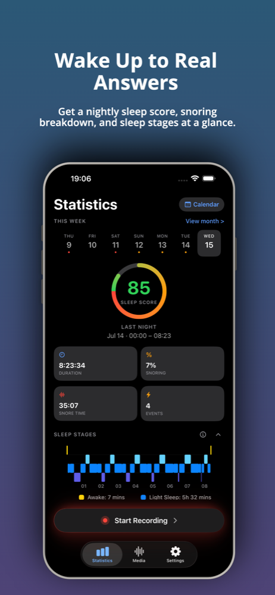

# SleepGuard

> Your bedside sleep lab. SleepGuard listens while you sleep, detects and records snoring and sleep talking, then scores your sleep and shows you how it trends over time.

**100% on-device.** All audio analysis runs locally on your iPhone using Apple's `SoundAnalysis` framework. No accounts, no servers, no audio ever leaves your phone.

📐 **How it's built and why:** the [Technical Overview](docs/TECHNICAL_OVERVIEW.md) covers the architecture, every package, the detection and scoring algorithms, Swift 6 concurrency, dependency injection, testing and CI, and the design decisions behind them.

🧩 **Built on a shared core.** The domain rules, strings, design system and screen layouts live in [SleepGuardShared](https://github.com/dardan0x/SleepGuardShared), a versioned Swift package this app builds against. This repo holds the app's architecture: persistence, services, dependency injection, navigation and screens. [How the two connect](#how-it-uses-sleepguardshared).


<p align="center">
  
  
  
  
  
  
</p>

---

## What it does

SleepGuard turns your phone into a bedside monitor. Start a session, set it on your nightstand, and it captures the sounds of your night — then in the morning you get a sleep score, a timeline of what happened, and audio clips you can play back.

### Core capabilities

| | Feature | What it does |
|---|---------|--------------|
| 🌙 | **Live sleep session** | Bedside-clock UI with a real-time level meter, snoring glow, and live event detection. Keeps recording in the background, recovers from interruptions and route changes, saves automatically when the battery runs critically low, and can restore a night after a crash. |
| 🔊 | **Snore & sleep-talk detection** | Classifies **snoring** (quiet · light · loud · epic) and, optionally, **sleep talking**, using Apple's on-device sound classifier and the sound level. An FFT-based fallback is implemented and waiting for real-night validation. |
| 📊 | **Sleep quality score** | A 0–100 score derived from snoring percentage, event frequency, sleep-talking, and (when available) sleep-stage architecture. |
| 🎧 | **Audio playback** | Browse past nights, jump between events, and play each event's clip, with optional enhanced audio (normalization + bandpass cleanup). |
| 📈 | **Trends & statistics** | Dashboard, calendar, "Last 7 Nights" view, and weekly/monthly Swift Charts for sleep score, snoring time, and event frequency. |
| ⌚ | **Apple Watch + HealthKit** | Reads sleep stages from Apple Watch, overlays a hypnogram on your timeline, and writes sleep sessions back to Apple Health. |
| 📄 | **PDF sleep reports** | Export a polished report — score, stats, sleep-architecture breakdown, and a full event log — to share with a doctor or partner. |
| 🎵 | **Snore Interrupter** | An optional melody that plays when snoring is detected (built-in library + record-your-own). Recording pauses while it plays, and the gap counts as snoring only if snoring resumes afterwards. |
| ⏰ | **Delayed start** | Start recording after a countdown (15 min – 1 h), so falling asleep isn't recorded. |
| 🔒 | **Privacy-first** | Everything lives locally in SwiftData. No sign-in, no cloud, no tracking. |

---

## How detection works

```
AVAudioEngine tap ──► level (RMS + peak dB) + SoundAnalysis snore / speech confidence
      │
      ▼  sampled every 50 ms
per-sample classifier ──► none · quiet · light · loud · epic
      │
      ▼  one ordered stream into the DetectionEngine actor
event rules: sustained ≥ 75 ms to start · 10 s silence to close · false-positive filters
      │
      ▼
NightEventRecord (bursts, intensity, duration) ──► per-event audio clip (.m4a)
```

- **Events** group continuous activity, merging brief breathing pauses (≤10 s) so one snoring spell is one event, not fifty.
- **Bursts** track the actual snoring segments inside an event, so "snoring time" reflects real snoring, not the silent gaps.
- Detection sensitivity is user-tunable (three presets, 5 dB apart), and sleep-talking detection is an opt-in toggle.
- The classifiers and the event rules are pure code in `SleepCore` (SleepGuardShared). This app supplies the audio and performs the outputs. Replay tests pin the rules' output on excerpts of a real night.
- Details: [Technical Overview §5](docs/TECHNICAL_OVERVIEW.md#5-snore-detection) and [`docs/snore-detection-algorithm.md`](docs/snore-detection-algorithm.md).

**Sleep score** starts at 100 and subtracts capped penalties for snoring time, snoring episodes per hour, snoring intensity, sleep talking, very short or long nights, and (when Watch data is present) sleep stages, against sleep-literature targets (deep ≥ 15%, REM ≥ 18%, awake ≤ 8%). The coefficients are product heuristics, not a clinical measure. Formula and worked example: [Technical Overview §6](docs/TECHNICAL_OVERVIEW.md#6-sleep-score).

---

## Architecture

> The short version is below. For the reasoning behind each decision (packages, MV instead of MVVM, Factory DI, the detection actor, Swift 6 isolation), see the [Technical Overview](docs/TECHNICAL_OVERVIEW.md) and the [architecture decision records](docs/adr/).

A modular Swift Package layout with strict isolation, enforced by the compiler through each `Package.swift`:

```
App target                 composition root, route registry, Firebase
└─► Feature packages       Onboarding · SleepSession · Statistics · Recordings · Settings · Personalization · Learn
    ├─► DesignSystem       AppTheme, model → component adapters; re-exports the shared kits and Strings
    ├─► Services                services behind protocols, Factory container, session lifecycle, HealthKit
    │   └─► AudioEngine    AVAudioEngine tap, SoundAnalysis, clip extraction
    ├─► Models             SwiftData @Models, schema, score cache, @Model → Night mapping
    └─► Routing            route enums + RouterPath (leaf)
            │
            ▼
SleepGuardShared           SleepCore · SleepStrings · SleepMelodies · SleepGuardDesignKit · SleepGuardContentKit
(pinned release)
```

- Each layer depends only on layers below it. `Models` depends only on `SleepCore`; `Routing` on nothing.
- **Feature packages never import each other.** They talk through route enums in the leaf `Routing` package (`RouterDestination`, `SheetDestination`; see `docs/adr/0001-routing-package.md`), and only the app target's `AppRegistry` maps a route to a concrete screen. The one deliberate exception is `Settings → Personalization` (the embedded profile section).
- The widget extension reuses `Models` + `DesignSystem` and reads a JSON snapshot from the App Group, never SwiftData.

| Package | Size | Depends on | SleepGuardShared | Responsibility |
|---------|------|-----------|------------------|----------------|
| `Models` | 13 files · 0.6k lines | — | SleepCore, SleepStore, SleepFiles, SleepLogging | SleepGuard's reads on the shared nights database (`NightRecord` / `NightEventRecord`, SleepStore: the same schema as SleepGuardUIKitWay's), the launch re-score of stale summaries, the file layout (`SleepGuardStorage`), widget snapshot. Re-exports `SleepStore` and `Log` |
| `AudioEngine` | 4 · 0.3k | — | SleepCore, SleepAudioKit | `AudioRecorder` over SleepAudioKit's `CaptureEngine` (the same capture as SleepGuardUIKitWay's): levels, confidences, interruptions, warm-up, melody pause; `LegacyClipPlayer` |
| `Services` | 37 · 3.7k | Models, AudioEngine, Factory | SleepCore, SleepMelodies | Services behind protocols and the Factory `Container`: `SessionManager`, `RealtimeDetectionTracker`, `SessionCommitter`, `HealthKitSync`, `UserPreferences`, `AppConfig`, the Snore Interrupter player, checkpoints, storage limits. No SwiftUI. Fakes in `ServicesTestSupport` |
| `Routing` | 1 · 47 | — | — | `RouterDestination`, `SheetDestination`, `RouterPath` |
| `DesignSystem` | 11 · 0.5k | Models, Factory | SleepCore, SleepStrings, DesignKit, ContentKit | The app's bridge to the shared UI: `AppTheme` (from `Theme.sleepGuard`), `SleepGuardKitAdapters`, a few app-only views. Re-exports the kits and `Strings` |
| `SleepSession` | 11 · 0.8k | Models, AudioEngine, Services, Routing, DesignSystem | SleepCore | Recording: pre-start, countdown, bedside clock, session summary |
| `Statistics` | 10 · 0.5k | Models, Services, Routing, DesignSystem | SleepCore | Home tab: dashboard, calendar, trends, Last 7 Nights |
| `Recordings` | 22 · 2.0k | Models, Services, Routing, DesignSystem | SleepCore | Sessions list, session detail (`SessionDetailModel`), clip player (`ClipPlaybackController`), sharing, PDF report |
| `Personalization` | 4 · 0.2k | Models, Services, DesignSystem | SleepCore | Morning briefing (`BriefingController`), profile prompt and editor |
| `Settings` | 4 · 0.5k | Models, Services, Routing, DesignSystem, Personalization | (via DesignSystem) | Sensitivity, HealthKit, melodies, storage, data, debug tools |
| `Onboarding` | 1 · 80 | Models, AudioEngine, Services, DesignSystem | SleepCore | First run and permission requests |
| `Learn` | 1 · 32 | Models, Services, Routing, DesignSystem | (via DesignSystem) | Learn tab, behind the `feature_learn` remote flag |

Feature packages are small because each keeps only its **screen**: loading and `ViewState`, `@Query`, `@Injected` services, `RouterPath`, sheets and alerts. The **layout** comes from `SleepGuardContentKit` and the **numbers** from `SleepCore` ([ADR 0006](docs/adr/0006-shared-screen-content.md)). The full package reference is in [Technical Overview §3](docs/TECHNICAL_OVERVIEW.md#3-packages).

**Patterns enforced project-wide:**
- `@State` + a `ViewState` enum per data-loading view — **no ViewModels**, no boolean soup.
- Dependencies resolve from a [Factory](https://github.com/hmlongco/Factory) container — views use `@Injected(\.service)`; `@Observable` classes resolve via `Container.shared` in init. Every service sits behind a protocol (`Factory<any SessionManaging>`, …) with a test double in `ServicesTestSupport` (`docs/adr/0002-protocol-services.md`). Feature packages never touch a service's `.shared`; only the app target (the composition root) does. Only `RouterPath` flows through SwiftUI `.environment`.
- All navigation goes through `RouterPath` (`RouterDestination` for push, `SheetDestination` for modals); each tab owns its own path.
- `async/await` everywhere — no Combine, no GCD, no completion handlers.
- **Swift 6 with strict concurrency everywhere** — language mode v6 in all packages, `SWIFT_STRICT_CONCURRENCY = complete` in the app target. `Sendable`/isolation violations are compile errors, fixed properly (never `@unchecked Sendable`). Core packages (`Models`, `Services`, `AudioEngine`) use explicit `@MainActor` annotations; the UI packages declare `MainActor` default isolation.
- **Remote-tunable without a release.** Feature flags and tab order live in `AppConfig` in `Services`, which has no Firebase dependency. `RemoteConfigLoader` in the app target is the only Firebase-aware code and pushes values into it. The sleep-score weights are built in (`SleepScoreConfig.default`); only Debug builds can override them.
- **Crash-safe recording.** During a session `SessionCheckpointStore` writes a recovery snapshot, so a night killed by the system at 4 a.m. can be restored instead of lost.
- **Add-only SwiftData schema.** Properties are only ever added, always with defaults, never renamed or removed, so existing installs never crash on migration. Every container opens through a `VersionedSchema` migration plan (V1, no stages yet), ready for the first change that needs one. `SleepSession` caches its score (versioned, recomputed at launch when the formula changes) so lists never load the `events` relationship.
- **Detection runs off the main actor.** Samples, melody stops, settings changes and session end go into one ordered `AsyncStream`; the `DetectionEngine` actor runs the pure state machine and hands outputs back in order (`docs/adr/0003-detection-actor.md`). Replay tests pin its output on excerpts of a real night.
- **Third-party code is minimal.** Packages use only [Factory](https://github.com/hmlongco/Factory) (plus this project's own SleepGuardShared). Firebase (Remote Config, Messaging, Crashlytics) is linked in the app target only and never touches audio.
- **Small views, enforced** — no view file over 200 lines (CI: `scripts/check-view-size.py`, with a ratcheting allowlist for existing offenders), containers under 100; sections are extracted as dedicated view structs (not computed `some View` properties), and sheets/alerts are enum-driven, not boolean flags.
- **UI layering** — only view files import `DesignSystem` for UI chrome, `Services` never imports SwiftUI, and feature packages never touch a service's `.shared`; enforced by `scripts/check-layering.py` in CI.
- Every user-facing string is localized through a generated `Strings` enum.

### Why no ViewModels

SwiftUI views are already value-type descriptions of state, and the Observation framework (iOS 17) lets a view observe `@Observable` services directly. A ViewModel layer would mostly be a mirror of the service, so we skip it:

- **No duplicated state.** Views read the `@Observable` services directly. Observation re-renders only on the properties `body` actually reads, so a ViewModel would add no performance benefit.
- **Local UI state stays local.** Each view's `@State` + `ViewState` enum makes impossible states unrepresentable, with no separate class needed.
- **Less boilerplate.** A ViewModel would mostly forward service calls, and each one is another file for both humans and agents to keep in sync.
- **Big view? Split it, don't add a ViewModel.** Small views are enforced (≤ 200 lines), and each extracted subview owns its own state.
- **DI works outside views.** Plain `@Environment` only resolves inside a view, which is the main reason people still reach for ViewModels. The Factory container resolves anywhere, so an `@Observable` class can get its services without a view.
- **The exception is deliberate.** A dedicated `@Observable` state owner is used only when a screen has real stateful or async workflow logic (`SessionDetailModel`: load, filter, delete; `ClipPlaybackController`: playback).

**Testability doesn't need ViewModels.** Logic lives in plain Swift outside the views (*humble view* / *functional core, imperative shell*), so tests call it directly, with no SwiftUI and no mocks (real services + an in-memory SwiftData `TestStore`):

**211 Swift Testing tests across 7 packages** here. The rules and layouts are tested once, in SleepGuardShared (251 tests). All run in CI:

| Where | Tests | What's covered |
|---------|------:|----------------|
| `Models` | 13 files · 0.6k lines | — | SleepCore, SleepStore, SleepFiles, SleepLogging | SleepGuard's reads on the shared nights database (`NightRecord` / `NightEventRecord`, SleepStore: the same schema as SleepGuardUIKitWay's), the launch re-score of stale summaries, the file layout (`SleepGuardStorage`), widget snapshot. Re-exports `SleepStore` and `Log` |
| `Services` | 63 | Detection through the live tracker, saving a night (`SessionCommitter`), service overrides with fakes, constructor injection, storage limits, checkpoints, raw-log writer, recording delay |
| `AudioEngine` | 4 · 0.3k | — | SleepCore, SleepAudioKit | `AudioRecorder` over SleepAudioKit's `CaptureEngine` (the same capture as SleepGuardUIKitWay's): levels, confidences, interruptions, warm-up, melody pause; `LegacyClipPlayer` |
| `Statistics` | 11 | `DashboardState` mapping |
| `Recordings` | 10 | `SessionDetailModel` (load / filter / delete) with a fake HealthKit |
| `DesignSystem` | 7 | Formatters, localization catalog, theme override |
| `Routing` | 3 | `RouterPath` navigation and sheets |
| SleepGuardShared | 251 | Score, detection state machine and replay goldens, statistics, playback, briefing, report; every component and screen content rendered in two themes |

### CI and guardrails

| Workflow | Runs on | Checks |
|----------|---------|--------|
| `tests` | Every PR (`macos-26`) | All tests, per package on the iOS Simulator (`scripts/run-tests.sh`) |
| `quality` | Every push + PR | SwiftFormat lint, no hardcoded user-facing strings in the diff (the catalog and its generated `Strings.swift` are checked in SleepGuardShared's CI) |
| `layering` | Every push + PR | No UI imports in non-view code, no SwiftUI in `Services`, no service `.shared` in feature packages (`scripts/check-layering.py`); no view file over 200 lines unless allowlisted (`scripts/check-view-size.py`) |

A pre-commit hook (`scripts/install-hooks.sh`) runs SwiftFormat on staged Swift files, so lint failures are caught before they reach CI.

---

## How it uses SleepGuardShared

[SleepGuardShared](https://github.com/dardan0x/SleepGuardShared) is a versioned Swift package that holds everything architecture-independent: domain values and rules (`SleepCore`), the string catalog (`SleepStrings`), melody resources (`SleepMelodies`), design tokens and components (`SleepGuardDesignKit`) and screen layouts (`SleepGuardContentKit`). This repo keeps what makes it *this* app: SwiftData, services, Factory, `RouterPath` and the screens that load data and host those layouts.

### How each package connects to it

```
SleepGuard                        SleepGuardShared
────────────────────────          ────────────────────────────────────────────────
Feature packages ───────────────► SleepGuardContentKit    screen layouts (via DesignSystem)
DesignSystem ───────────────────► SleepGuardDesignKit     Theme, components
     └──────────────────────────► SleepStrings            string catalog
Models ──────────────┐
AudioEngine ─────────┤
Services ─────────────────┤
Statistics ──────────┼──────────► SleepCore               domain values, rules, detection
Recordings ──────────┤
SleepSession ────────┤
Personalization ─────┤
Onboarding ──────────┘
Services ────────────────────────────► SleepMelodies           melody resources
```

Domain packages (`Models`, `AudioEngine`, `Services`) map their data to `SleepCore` values and run the shared rules and detection engine. Feature packages call the rules they show (statistics, playback, briefing) and host the shared layouts. `DesignSystem` is the single UI entry point: it re-exports the kits and `Strings`, so a feature needs only `import DesignSystem`. `Routing` uses nothing shared.

### The seams

| Seam | Shared type | How this app connects to it |
|---|---|---|
| **Domain values** | `Night`, `NightSummary` | Mapped from SwiftData at the `Models` boundary. Lists use the cached summary fields; screens that show a night build `Night` |
| **Detection** | `DetectionEngine` (actor) | One ordered `AsyncStream` of timestamped messages from `RealtimeDetectionTracker`; outputs performed on the main actor ([ADR 0003](docs/adr/0003-detection-actor.md)) |
| **Theme** | `Theme`, `\.theme` | `AppTheme` set once at the root; every kit component and content view reads it from the environment |
| **Screen content** | `*Content` views | A container view loads (`@Query` or a state owner), owns `ViewState`, and passes values, closures and slots. Closures set sheet state or call `RouterPath` |

The night's detail, as hosted here. App-only pieces go into the content's slots:

```swift
NightDetailContent(
  night: night, summary: night.summary(using: appConfig.sleepScoreConfig),
  filters: model.filters, filter: $model.selectedFilter,
  onPlay: { row in activeSheet = .player(initialEvent: model.event(for: row)) },
  onShowAll: { _ in activeSheet = .events },
  onShare: { row in if let event = model.event(for: row) { shareCoordinator.shareEvent(event, in: session) } },
  stages: { SleepStagesSection(session: session, scoreConfig: appConfig.sleepScoreConfig) },
  footer: { ShortEventsButton(count: model.shortEvents.count) { activeSheet = .shortEventsPlayer } })
```

### What stays here

- **Persistence.** The `@Model` schema, its migration plan and the score cache are this app's. Nothing in SleepGuardShared knows SwiftData exists.
- **Services and lifecycle.** Recording, interruptions, HealthKit, checkpoints, storage enforcement and the widget snapshot live in `Services` and `AudioEngine`.
- **Composition and navigation.** Factory, `@Injected`, `RouterPath`, sheets and deep links.
- **Configuration.** Remote Config feeds feature flags and tab order into `AppConfig`. The score weights are `SleepCore`'s `SleepScoreConfig.default`; only Debug builds override them.

### Binding and releases

| Build | Uses |
|---|---|
| Unreleased shared changes | Add `../SleepGuardShared` to the workspace in Xcode for the time being (it overrides the pin; don't commit that) |
| `SleepGuard.xcworkspace`, `SleepGuard.xcodeproj`, `scripts/run-tests.sh`, CI | The pinned release: `.package(url: …, exact: "0.37.0")` in every package manifest, and the same exact pin in the project (Package Dependencies), linked by the app and widget targets |

Both modes resolve the same package identity, so no manifest changes between them. Adopting a release means running `sh scripts/bump-shared.sh <version>` (it moves every pin and both lockfiles), then the full suite. The shared repo's CI builds this app against every candidate commit, so a breaking change fails there before it's tagged.

### How it was extracted

The shared code started here. It moved out incrementally (27 releases), one concern at a time: the score, then detection, then every night metric, statistics, playback, the briefing and the report; then the strings; then the design kit; then each screen's layout. Each step followed the same path: pin the behaviour with this app's tests, turn hidden inputs (models, `Date()`, randomness) into parameters, move the rule as a pure function over values, map at the `Models` boundary with parity tests, release, bump, delete the local copy. The decisions are recorded in [ADR 0004](docs/adr/0004-shared-repo.md) (shared repo), [0005](docs/adr/0005-shared-design-kit.md) (design kit) and [0006](docs/adr/0006-shared-screen-content.md) (screen content).

The same package also backs [SleepGuardUIKitWay](https://github.com/dardan0x/SleepGuardUIKitWay), a UIKit-shell build of this product. Its [comparison](https://github.com/dardan0x/SleepGuardUIKitWay/blob/main/docs/COMPARISON.md) sets one feature side by side in both shapes.

---

## Requirements

- iOS 17.6+ (iPhone and iPad)
- Xcode 26+ (Swift 6.2 toolchain)
- Swift 6 language mode with strict concurrency (all packages + app target)
- [SleepGuardShared](https://github.com/dardan0x/SleepGuardShared) checked out next to this repo (`../SleepGuardShared`) to build the workspace; the project alone resolves the pinned release from GitHub
- A physical device for real recording (the simulator uses the Mac's microphone, which is enough for a demo)

## Build & run

```bash
xcodebuild -project SleepGuard.xcodeproj \
  -scheme SleepGuard \
  -destination 'platform=iOS Simulator,name=iPhone 17 Pro,OS=26.2' \
  build
```

Or open `SleepGuard.xcworkspace` (or `SleepGuard.xcodeproj`; both use the pinned shared release) in Xcode, select the **SleepGuard** scheme, and run. Package tests: `sh scripts/run-tests.sh` (all) or `sh scripts/run-tests.sh Models Services`.

> **Tip:** launch with the `-generateMockData` argument in a DEBUG build to populate the dashboard with a realistic month of sample nights — handy for previewing trends and screenshots.

## Project structure

```
SleepGuard/
├── SleepGuard/              # App target, the composition root
│   ├── App/                 #   SleepGuardApp (launch, store opening), StoreUnavailableView
│   ├── Tabs/                #   MainTabView, CustomTabBarView, one file per tab
│   ├── Navigation/          #   AppRegistry (route → screen), DeepLinkRouter
│   ├── NightFlow/           #   SessionFlowHost (end of a night, root modals), processing overlay
│   ├── Widgets/             #   WidgetSnapshotWriter
│   ├── RemoteConfig/        #   RemoteConfigLoader (the only Firebase-aware code)
│   └── PushNotifications/   #   AppDelegate, notification soft-ask
├── SleepGuard.xcodeproj/     # Builds against the pinned SleepGuardShared release
├── SleepGuard.xcworkspace/  # The project; SleepGuardShared comes pinned, under Package Dependencies
├── Packages/              # 15 local packages, shown as the Packages folder in the project (not under Package Dependencies)
├── SleepGuardWidgets/       # Widget extension: reads a JSON snapshot from the App Group
├── WatchApp/                # watchOS companion sources (not yet an Xcode target)
├── designs/
│   ├── SleepGuard.pen       # Pencil design source — single source of truth for UI
│   └── screenshots/         # Reference screenshots
├── scripts/                 # Test runner, bump-shared.sh, localization codegen, layering + view-size CI checks
└── docs/                    # ADRs, feature docs and trackers, session summaries

../SleepGuardShared/         # Shared rules, strings, melodies, design kit, screen content (its own repo)
```

## Design

The entire UI is built against a single design source — [`designs/SleepGuard.pen`](designs/SleepGuard.pen) (Pencil format) — using a dark-first theme. Selected tokens:

| Token | Value | | Token | Value |
|-------|-------|---|-------|-------|
| `bg-primary` | `#000000` | | `score-green` | `#30D158` |
| `bg-card` | `#2C2C2E` | | `score-amber` | `#FF9F0A` |
| `accent` | `#5E9CFF` | | `score-red` | `#FF453A` |
| `text-primary` | `#FFFFFF` | | `radius-card` | `16` |
